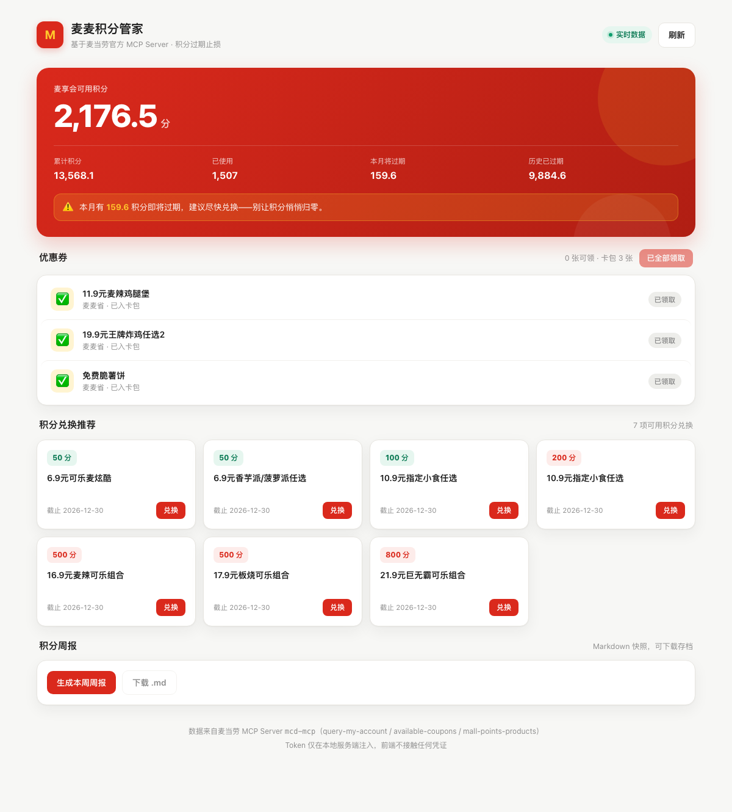
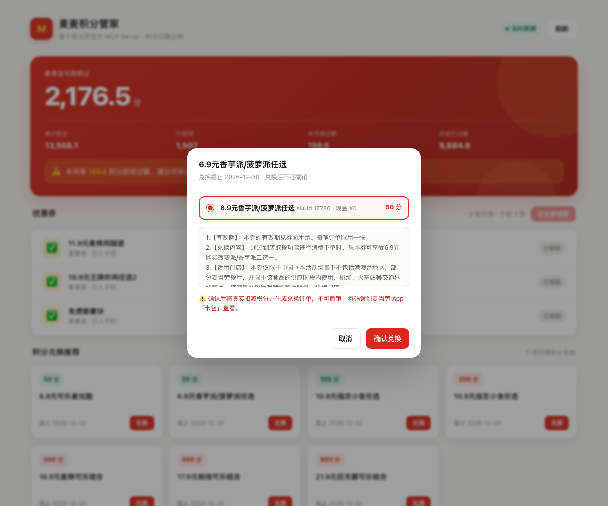

# mcd-points-butler

**A complete MCP Streamable HTTP client in ~500 lines of Python standard library — plus a real, working case study on top of it.**

> [中文](README.md) | English

[](https://www.python.org/)
[]()
[](https://modelcontextprotocol.io)



---

## What this is

Two things in one repo — one technical, one practical:

1. **`McpClient`** — a dependency-free MCP (Model Context Protocol) client built only on `urllib`: `initialize` handshake, `notifications/initialized`, `Mcp-Session-Id` passthrough, `tools/call`, SSE frame parsing, and 202-empty-body tolerance. Copy it if you need MCP without dragging in an SDK.
2. **A points butler for McDonald's China's loyalty program** — built on the official `mcd-mcp` server (35 tools). Expiring-points alerts, one-tap coupon claiming, and real redemption of points-mall vouchers. **Every screenshot and output below comes from a real account, not mock data.**

## What the case study does

| Capability | MCP tools used | Notes |
|---|---|---|
| Points snapshot & expiry alert | `query-my-account` | Warns when points are about to expire this month |
| One-tap coupon claim | `available-coupons` + `auto-bind-coupons` | Button disables itself once everything is claimed |
| Wallet verification | `query-my-coupons` | Confirms coupons actually landed in the wallet |
| Redemption suggestions | `mall-points-products` | Filters by affordable points, **excludes items past `downTime`** |
| Real redemption | `mall-product-detail` + `mall-create-order` | Pick SKU → confirm → order id returned |
| Weekly report | combination | Markdown output, cron-friendly |

Redemption dialog (SKU picker + terms + second confirmation):



Real CLI output:

```text
== Points snapshot ==
Available   : 2,176.5
Lifetime    : 13,568.1
Expiring    : 159.6
[!] 159.6 points expire this month (threshold 100.0)

== Claimable coupons ==
- 11.9元麦辣鸡腿堡        [claimable]
- 19.9元王牌炸鸡任选2     [claimable]
- 免费脆薯饼              [claimable]
```

## Install

Zero dependencies, Python 3.8+.

```bash
git clone https://github.com/cnJason/mcd-points-butler.git
cd mcd-points-butler

export MCD_MCP_URL="https://mcp.mcd.cn/"      # optional, this is the default
export MCD_MCP_TOKEN="<your McDonald's MCP token>"
```

> The token is only ever read from the environment. No credential is committed to this repo.

## Usage

```bash
python3 mcd_butler.py serve             # web dashboard at http://127.0.0.1:8787
python3 mcd_butler.py points            # points snapshot + expiry alert
python3 mcd_butler.py coupons           # list claimable coupons
python3 mcd_butler.py coupons --claim   # claim all
python3 mcd_butler.py mall              # redemption suggestions
python3 mcd_butler.py detail --spu 17073                     # product detail + SKUs
python3 mcd_butler.py redeem --spu 17073 --sku 17779         # dry run (no points spent)
python3 mcd_butler.py redeem --spu 17073 --sku 17779 --yes   # actually redeem
python3 mcd_butler.py report            # generate weekly report
python3 mcd_butler.py all               # everything, suitable for cron
```

The dashboard supports deep links: `http://127.0.0.1:8787/#redeem=17073` opens the redemption dialog for that item.

## Design notes

### MCP gotchas this project hit (days of your time saved)

| Gotcha | Symptom | Fix |
|---|---|---|
| `notifications/initialized` returns 202 with an empty body | `json.loads("")` raises | Return `{}` on empty body |
| Server may reply with `text/event-stream` | JSON parsing fails | Parse `data:` frames, take the last one |
| `Mcp-Session-Id` must be echoed | Some servers drop the session otherwise | Capture during `initialize`, send afterwards |
| `status=2` does not mean "on sale" | Items past `downTime` still show up in the list; the detail call then says "delisted" | Filter locally on `downTime >= now` |
| `auto-bind-coupons` returns `data: null` when nothing to claim | `.get("data", {})` yields `None`, next `.get` crashes | `or {}` fallback |

### Three gates around redemption

Redemption spends real points and is irreversible:

1. **Capability filter** — only affordable, non-expired items are shown;
2. **Second confirmation** — the web UI requires an explicit confirm; the CLI only dry-runs without `--yes`;
3. **Balance pre-check** — the CLI compares `points` against `availablePoint` and refuses before sending any request.

### Web architecture: the browser never touches the token

```
Browser (web/index.html, single file, no deps)
   │  fetch /api/*
   ▼
Local Python server (http.server, 127.0.0.1:8787, token stays in-process)
   │  tools/call
   ▼
McDonald's MCP server (mcd-mcp)
```

Endpoints (localhost only):

| Method | Path | Purpose |
|---|---|---|
| GET | `/` | dashboard |
| GET | `/api/points` | points snapshot |
| GET | `/api/coupons` | claimable coupons |
| POST | `/api/coupons/claim` | claim all |
| GET | `/api/my-coupons` | wallet |
| GET | `/api/mall?max=500` | redemption suggestions |
| GET | `/api/mall/detail?spuId=17073` | product detail + SKUs |
| POST | `/api/mall/redeem` | create redemption order |
| GET | `/api/report` | weekly report (Markdown) |

Opening `web/index.html` without the backend falls back to built-in demo data, so the UI is reviewable without a token.

## Who this is for

- **MCP developers** who want a readable, dependency-free Streamable HTTP client to adapt
- **Loyalty members** sitting on points they keep forgetting to redeem
- **WorkBuddy users** who want the whole thing on a schedule

## Layout

```
mcd-points-butler/
├── README.md / README.en.md       # bilingual docs
├── CONTEST_DECLARATION.md         # contest declaration
├── MCP_INTEGRATION.md             # MCP server / tools / flow / value
├── mcp-config.example.json        # sanitized config (env placeholder only)
├── workbuddy.md                   # WorkBuddy conversation context
├── mcd_butler.py                  # MCP client + CLI + web server
├── web/index.html                 # single-file dashboard
├── docs/                          # screenshots
└── reports/                       # generated weekly reports
```
